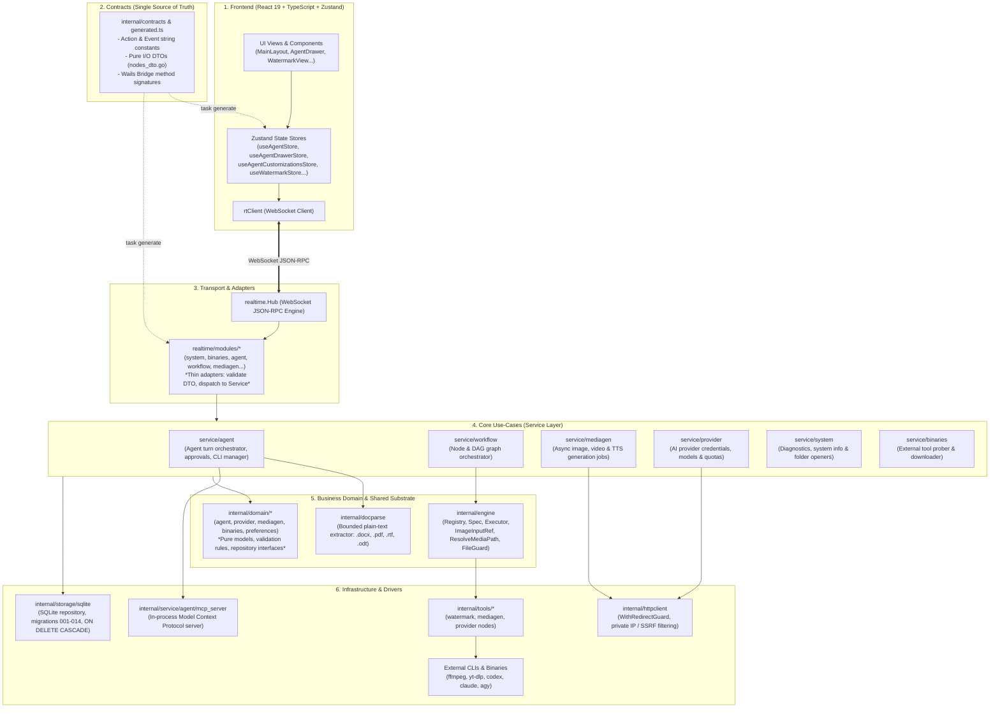
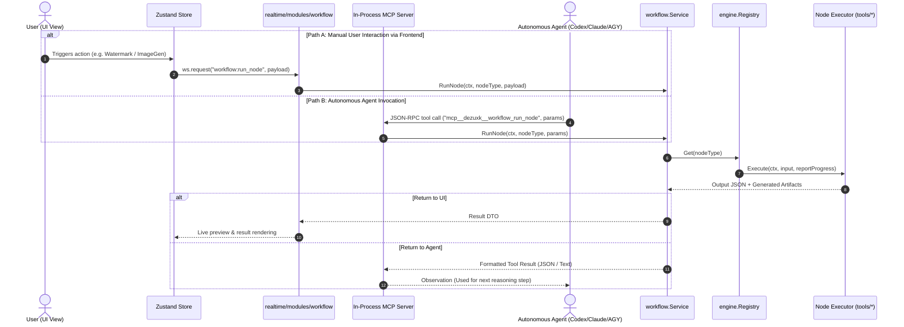
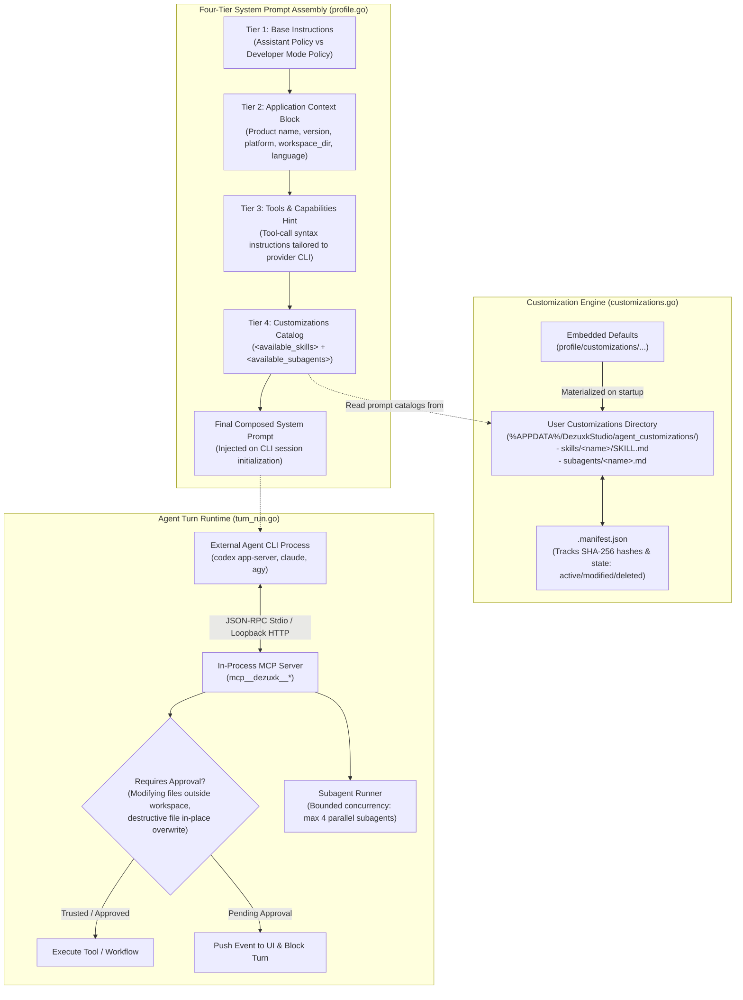
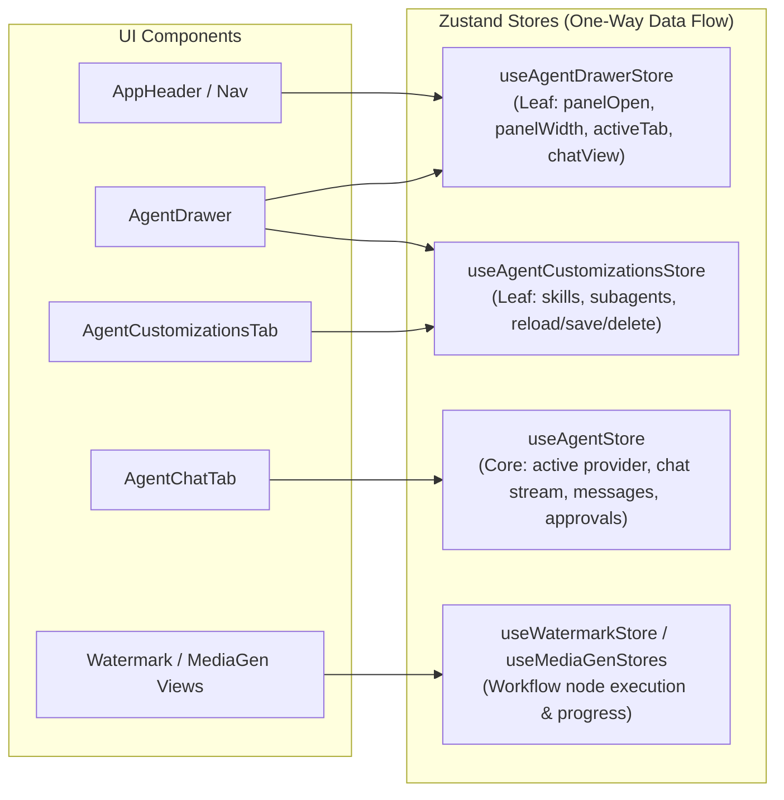

# DezuxkStudio – Comprehensive Architecture Blueprint & Developer Guide

This document is the authoritative architectural blueprint and engineering guide for **DezuxkStudio**. It describes the system topology, component interactions, runtime lifecycles, and developer recipes established after the comprehensive Phase 1–5 architectural refactoring.

Every developer and AI agent working on this repository must adhere to the boundaries, layering principles, and contracts defined here.

---

## 1. System Layer Map & Dependency Rules

DezuxkStudio follows strict **Clean Architecture (Ports & Adapters)** principles. Dependencies flow strictly in one direction:
$$\text{Transport (Modules)} \longrightarrow \text{Use Cases (Service)} \longrightarrow \text{Domain Models} \longleftarrow \text{Infrastructure (Storage)}$$

The `internal/contracts` package serves as the **Single Source of Truth** for all data crossing the Go $\leftrightarrow$ TypeScript boundary.



### Architectural Invariants:
1. **Zero Circular Dependencies**: Enforced by static AST analysis (`cycles.mjs` on frontend, `go list` on backend). Cycle count is strictly `0`.
2. **Contracts Decoupling**: `internal/contracts` must never import implementation packages (`internal/tools/*`, `internal/service/*`). Node DTOs live in `internal/contracts/nodes_dto.go` and are aliased by tool packages.
3. **No Direct Storage in Services**: Services depend strictly on `domain.Repository` interfaces, never directly on `*sqlite.DB`.
4. **Configuration Centralization**: Every limit and tunable is defined in `internal/config/config.go` with defaults declared exclusively in `config.Default()`.

---

## 2. Dual-Execution Pipeline (UI & Agent Unified Runtime)

DezuxkStudio avoids duplicating logic between user-facing UI actions and autonomous AI agent actions. All media processing, generation, and inspection capabilities are defined as **Engine Nodes** registered within `engine.Registry`.

Both the UI and the Assistant interact with the same underlying engine through `workflow.Service`:



### Key Advantages:
- When a new node is created (e.g. Video Upscaler), **zero new agent code is needed**.
- The Agent automatically discovers the node via `mcp__dezuxk__workflow_list_specs`, understands input/output constraints from `engine.Spec`, and executes it via `workflow_run_node`.
- Security policies, progress reporting, and path sanitization apply identically across both execution paths.

---

## 3. Agent Subsystem: System Prompts, Skills & Customizations

The Agent subsystem (`internal/service/agent`) connects external AI CLI processes (Codex app-server, Claude Code CLI, Antigravity ACP) to local workspace tools through an in-process MCP server.



### Layered System Prompt Composition:
1. **Tier 1 (Base Policy)**: Enforces core safety rules, prevents hallucinations, requires structured tool outputs, and sets read-only vs. workspace-write constraints.
2. **Tier 2 (Environment Block `<application>`)**: Automatically passes current OS platform, client version, workspace root, and active UI language (`interface_language`), allowing the agent to reply in Vietnamese or English matching user preference.
3. **Tier 3 (Tool Guidance)**: Injects protocol-specific tool invocation hints matching the target CLI (Codex app-server vs. Claude CLI vs. ACP).
4. **Tier 4 (Customizations Catalog)**: Dynamically injects `<available_skills>` and `<available_subagents>` parsed from Markdown files on disk. The agent inspects `description` fields to autonomously decide which skill to invoke.

### Customization Hot-Reloading:
- Custom skills and subagents reside as Markdown files with YAML frontmatter in `%APPDATA%/DezuxkStudio/agent_customizations/`.
- Users can add, modify, or restore skills via the UI (`useAgentCustomizationsStore`) or directly edit files on disk.
- Calling `agent:reload_customizations` refreshes the prompt catalog in memory immediately without restarting the application or rebuilding binaries.

### Safety & Approval Gate:
- Actions marked `Destructive` (such as in-place watermark removal overwriting user originals) or file writes outside the registered trusted directories trigger the `approvals.go` gate.
- The turn is paused, and an `agent:approval_required` event is pushed to the UI. The operation only executes after explicit user approval.

---

## 4. Frontend State Architecture (Zustand Stores)

The frontend splits state into atomic, single-responsibility stores to prevent unnecessary component re-renders:



- **`useAgentDrawerStore`**: Controls drawer visibility, width (synced with `localStorage`), and navigation tabs (`chat`, `connections`, `customizations`).
- **`useAgentCustomizationsStore`**: Manages CRUD operations for skills and subagents, error reporting, and directory opening.
- **`useAgentStore`**: Retains core conversation history, streaming message accumulation, turn cancellation, and pending approvals.

---

## 5. Security & Isolation Boundaries

### Server Mode (`--mode server`):
When running as a headless core server, DezuxkStudio enforces strict security boundaries:
- **`server.allow_host_admin` (Default: `false`)**: 
  - Remote clients cannot mutate host paths (`binaries:set_path`, `agent:set_path`).
  - Remote clients cannot trigger OS folder openers (`system:open_folder`).
  - Remote clients cannot create or edit host-level skills or subagents (`agent:save_skill`, `agent:delete_skill`).
  - Attempted mutations immediately return `ERR_UNAVAILABLE`.
  - In contrast, AI generation and chat (`providers:*`, `agent:send_prompt`) remain fully accessible to authorized remote clients holding valid bearer tokens.

### Outbound HTTP & SSRF Protection:
- All outbound requests (media downloads, webhook polls, provider API queries) pass through `internal/httpclient`.
- Protected by `WithRedirectGuard`, capping redirects at 10 hops and validating destination IPs against private/loopback/link-local address ranges via `domainprovider.ValidateOutboundURL`.

---

## 6. Developer Extension Recipes

### Recipe A: Adding a New Processing Node (e.g. Video Upscaler)
1. **Define DTOs**: Add `VideoUpscaleInput` and `VideoUpscaleOutput` in `internal/contracts/nodes_dto.go`. Add `NodeTypeVideoUpscale = "tool.video_upscaler"`.
2. **Regenerate Contracts**: Run `task generate` to create matching TypeScript interfaces in `frontend/src/contracts/generated.ts`.
3. **Implement Node**: Create `internal/tools/upscaler/node.go`, defining `engine.Spec` with clear `Inputs`, `Outputs`, and `Params`. Implement `engine.Typed(spec, executeFunc)`.
4. **Register**: Add the node to `workflow.New(...)` in `internal/service/workflow/service.go`.
5. **Done**: Both UI workflows and Agent MCP tools immediately gain access to the new capability.

### Recipe B: Adding a New Custom Agent Skill
1. **Create Skill Folder**: Inside `%APPDATA%/DezuxkStudio/agent_customizations/skills/<skill-name>/`, create `SKILL.md`.
2. **Write YAML Frontmatter**:
   ```yaml
   ---
   name: <skill-name>
   description: Use when the user requests ... (Provide clear trigger criteria for the LLM)
   ---
   ```
3. **Write Markdown Instructions**: Document step-by-step instructions, constraints, and tool usage patterns.
4. **Verify**: Open the Assistant drawer, navigate to Customizations, click Reload. The skill will appear in `<available_skills>` in the next conversation turn.

### Recipe C: Adding a New Realtime Action (Frontend $\leftrightarrow$ Backend)
1. **Domain**: Define models and `Repository` interface in `internal/domain/<feature>/`.
2. **Service**: Implement use cases in `internal/service/<feature>/`.
3. **Contracts**: Declare `Action<Feature><Verb>` in `internal/contracts/actions.go` with request/response payloads. Run `task generate`.
4. **Module Adapter**: Register handler in `internal/realtime/modules/<feature>.go` calling the service.
5. **Composition Root**: Mount module in `internal/core/core.go`.
6. **Frontend**: Call `rtClient.request(Actions.<FEATURE>_<VERB>, payload)` from the appropriate store.

---

## 7. Verification Checklist for Changes

Every pull request or modification must pass the following gates:
```powershell
# Set Windows temp directory within workspace to satisfy Smart App Control
$env:GOTMPDIR = "$PWD\build\.gotmp"

# 1. Regenerate & verify contracts
go run ./cmd/contractgen -check

# 2. Go static analysis & unit tests
go vet ./...
go test -count=1 ./...

# 3. Race detector test suite
task test:race

# 4. Frontend typecheck, lint, formatting & tests
npm.cmd --prefix frontend run typecheck
npm.cmd --prefix frontend run lint
npm.cmd --prefix frontend run format:check
npm.cmd --prefix frontend run test:run

# 5. Full CI check suite
task check
```
